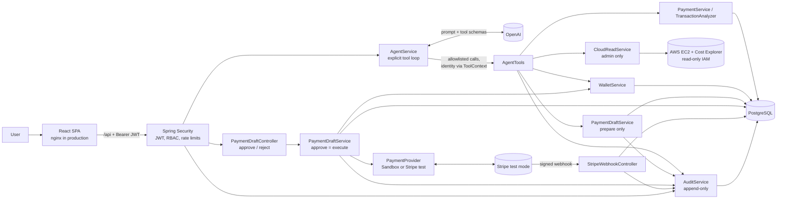
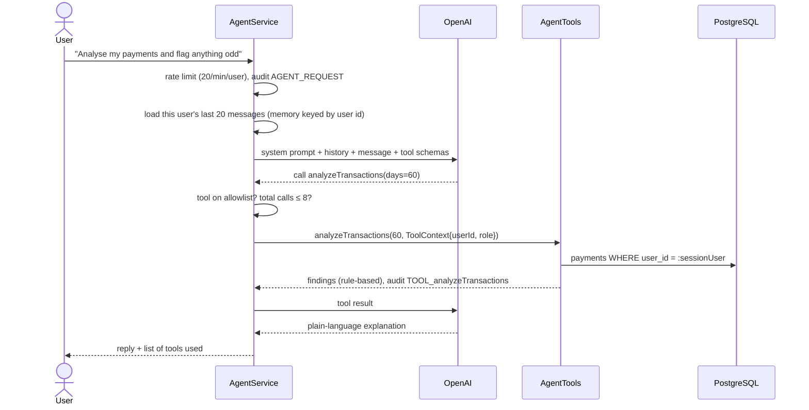
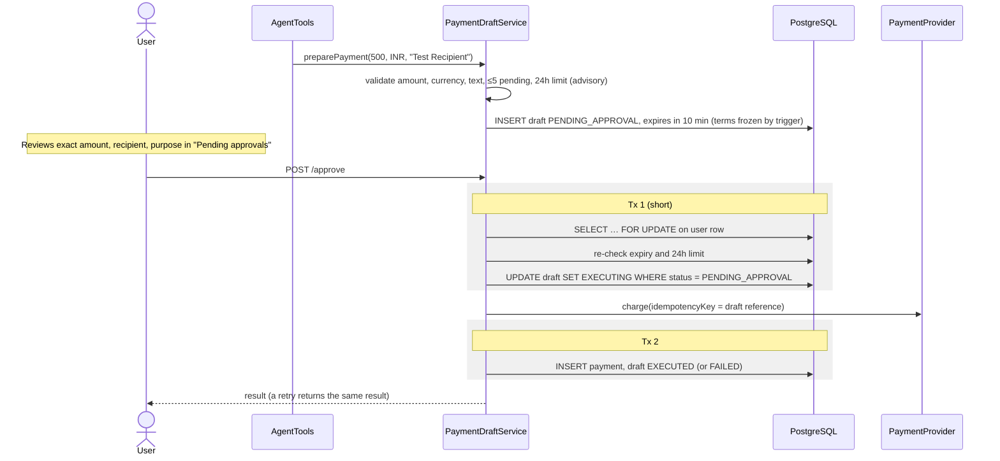
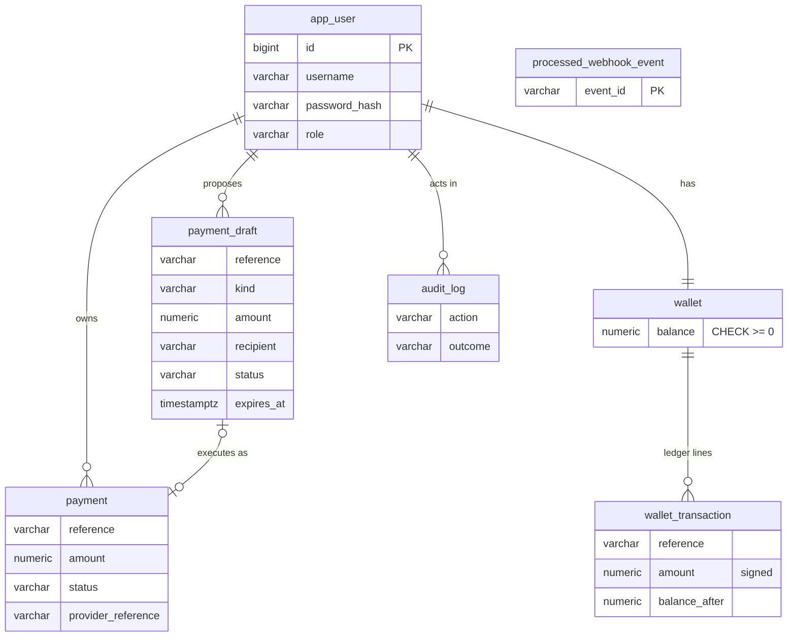

# Architecture

SecurePay AI lets a user ask for financial and cloud operations in plain language. The core design rule:
**the model can ask, but only backend code decides and acts.** Everything below follows from that.

## Components



Two separate entry points reach the money-moving code:

| Path | Who triggers it | What it can do |
|---|---|---|
| `POST /api/agent/chat` → `AgentTools` | The model, on the user's behalf | Read; **prepare** drafts |
| `POST /api/payment-drafts/{ref}/approve` | Only the signed-in user, in the UI | **Execute** one specific draft |

The model has no tool that reaches the second path. A unit test pins the exact list of tools.

## Chat request



The tool loop runs in our code (`internalToolExecutionEnabled(false)`), not inside the Spring AI model client.
That gives one place to:

- refuse any tool name that isn't registered, before it runs;
- cap tool calls per message (8), which stops runaway loops and runaway cost;
- report which tools were used to the UI and the audit log.

## Approval and execution



Wallet transfers use the same claim step, then move funds in **one** transaction: both wallets locked in
user-id order (so opposite transfers can't deadlock), two ledger lines written, and the draft marked executed.

If the server dies between the provider call and Tx 2, the draft stays `EXECUTING`. `PaymentRecoveryJob`
retries it after two minutes with the same idempotency key, so the provider returns the original result
instead of charging again.

## Data model



Database-level guarantees (they hold even if application code has a bug):

| Rule | Mechanism |
|---|---|
| Audit log and wallet ledger are append-only | `BEFORE UPDATE OR DELETE` triggers |
| A draft's amount, currency, recipient, description, kind and owner never change | `payment_draft_freeze_terms` trigger |
| No negative wallet balance | `CHECK (balance >= 0)` |
| Each webhook event is processed once | primary key on `processed_webhook_event.event_id` |

## Packages

```
com.securepay
├── agent/     AgentService (tool loop, memory, rate limit), AgentTools (the model's whole capability surface)
├── payment/   PaymentDraftService (prepare/approve/reject/recover), TransactionAnalyzer, webhook
│   └── provider/  PaymentProvider, SandboxPaymentProvider, StripePaymentProvider, StripeSignatureVerifier
├── wallet/    WalletService (ledger transfers), WalletTransaction
├── cloud/     CloudReadService (EC2 + Cost Explorer, read-only)
├── security/  JWT issue/verify, SecurityConfig (RBAC), login with brute-force limit
├── audit/     AuditService (REQUIRES_NEW, so failures are recorded too)
├── user/      AppUser, UserBootstrap (first admin in a fresh deployment)
├── config/    OpenAPI
└── common/    errors, RateLimiter
```
